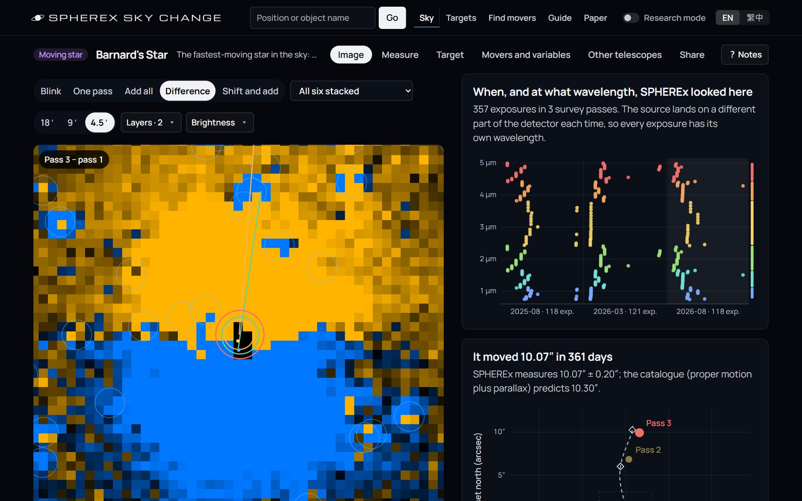
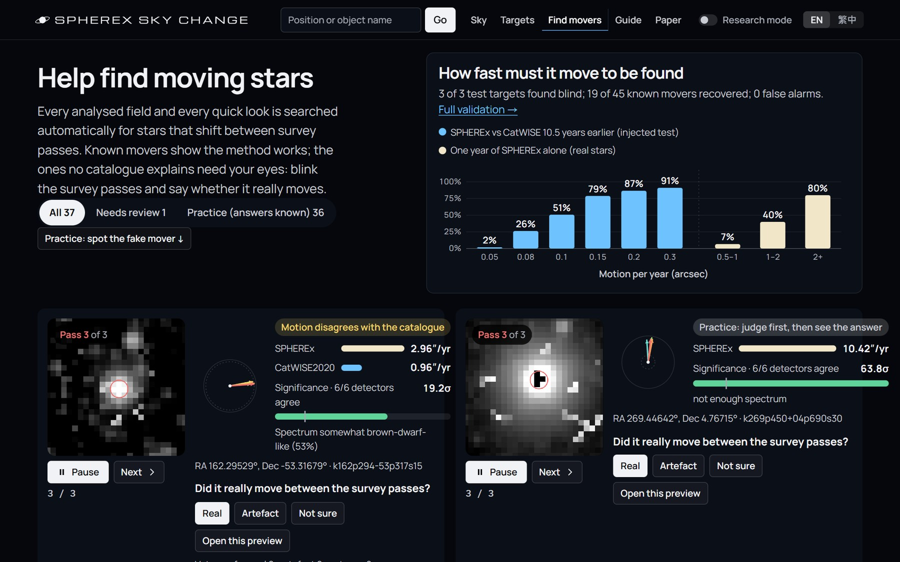
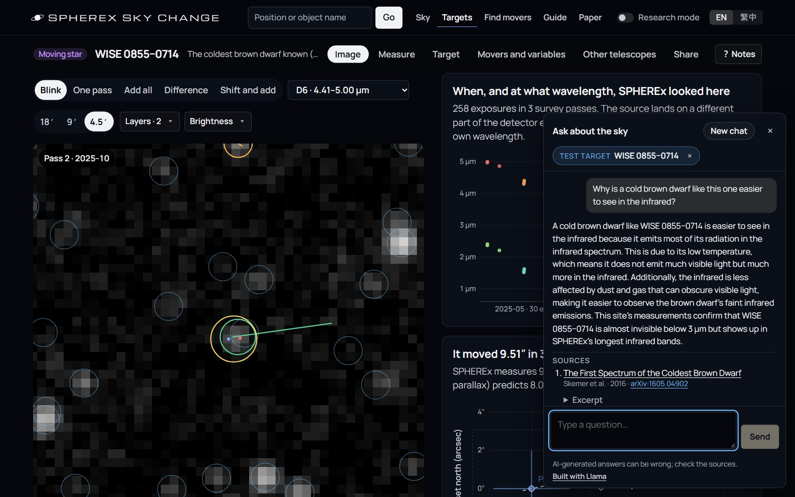
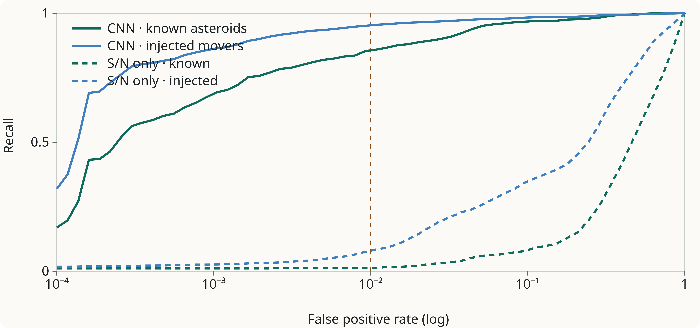
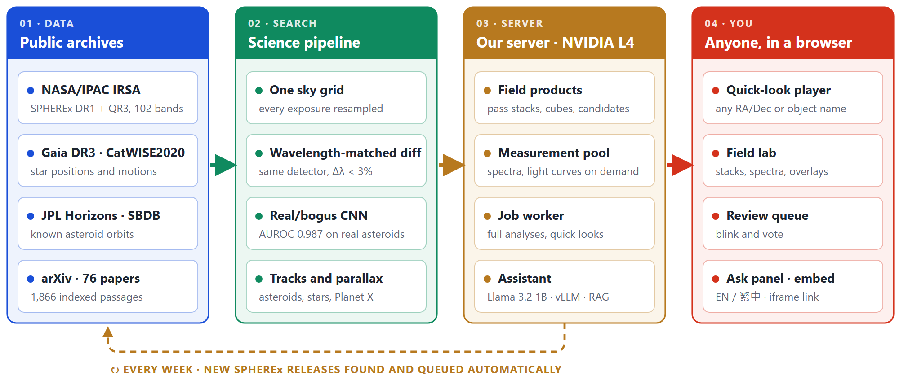

# SPHEREx Sky Change

**Type any star or sky position and watch every SPHEREx infrared image of it play in time order, then measure what moved, what changed and what it is.**

NASA Space Apps Challenge 2026 · *Planet X and SPHEREx* · Team Flying Minnie (Taiwan)

**[Live site](https://yu8bryan.com/)** · **[Video](VIDEO_URL)** · **[Space Apps project page](SPACE_APPS_URL)** · **[Paper](https://yu8bryan.com/paper/en.html)** · **[Validation](VALIDATION.md)** · **[Requirements met](REQUIREMENTS.md)**

<!-- TODO: replace VIDEO_URL (YouTube) and SPACE_APPS_URL (Space Apps project page) once they are published. -->


## Why it matters

Pluto, and hundreds of brown dwarfs found by Backyard Worlds volunteers, were spotted by blinking two pictures of the same sky taken at different times. SPHEREx now images the whole sky every six months in 102 near-infrared bands (0.75–5.0 µm), a new data set for this kind of search. It is also hard to blink: every pixel sees its own wavelength, so consecutive images of the same star are taken in different colours and a plain blink shows stars "changing" that are not. SPHEREx Sky Change handles this so that anyone with a browser can look for things that move, and see the measurements behind every claim.

## What it does

- **Quick look.** Enter an RA/Dec or a name; every overlapping SPHEREx exposure is fetched from NASA/IPAC IRSA, put on one sky grid and played in time order. First frames stream in within about a minute.
- **Field lab.** Per-pass stacks for each of the six detectors, wavelength-matched difference images, a spectrum and light curve for any clicked pixel, Gaia DR3 and CatWISE2020 overlays moved to the date of each pass, contamination flags, and an embeddable view (`/?ra=…&dec=…&embed=1`).
- **Four automatic searches.** Asteroids and comets (a CNN trained only on simulated movers), distant bodies such as a hypothetical Planet X (Earth-orbit parallax between passes), high-proper-motion stars, and variable stars.
- **Review queue.** Visitors blink and vote on every automatic candidate, with a practice mode.
- **Ask.** A chat on every page: Llama 3.2 1B fine-tuned by the team, self-hosted, answering from 76 papers and the site's own measurements, with sources.
- **Always current.** A weekly timer checks IRSA for new SPHEREx releases and queues re-analysis without a code change.

<p align="center">
  
</p>
<p align="center">
  
  
</p>

## What we found

Every number below comes from the evidence files in this repository (`paper_evidence/`, `VALIDATION.md`).

- **All five challenge targets measured.** Barnard's Star moved 10.07″ ± 0.20″ in 361 days (catalogue 10.30″); Epsilon Indi B 6.11″ ± 0.07″ in 497 days (6.16″); WISE 0855 9.5″ ± 2.0″ (8.1″); RW Aurigae and R Draconis have light curves measured from the wings of their saturated images.
- **Found blind.** The automatic searches find all three fast-moving targets and both variable targets without being told where to look.
- **A CNN that never saw a real asteroid.** Trained on 12,351 movers injected with each exposure's own PSF, it separates 556 real known-asteroid detections in 19 fields it never trained on with AUROC 0.987 (S/N alone: 0.537), keeping 90.8% at a 1.15% false-positive rate.
- **Planet X.** 47 of 48 injected distant bodies (500–3000 AU, with orbital motion) are recovered in fields with three survey passes. From SPHEREx parallax alone, a blind search measured Makemake at 52.71 AU (JPL 52.72) and Haumea at 49.49 AU (JPL 49.82). A search of 32 fields along the predicted path of Planet Nine found nothing beyond chance. **We have not found a new planet**, and an AI score or a vote is not a discovery.

<p align="center"></p>

## How it works



- **Wavelength-matched differences.** Each pixel's reference is built only from exposures of the same detector whose wavelength at that pixel is within 3% and that are at least 3 hours apart, so a difference image shows real change rather than colour.
- **Spectra on the fly.** Clicking a pixel collects one wavelength from each of hundreds of exposures; sorted by wavelength they form a spectrum, grouped by time a light curve.
- **Parallax for distant bodies.** Survey passes six months apart see a distant body shifted by Earth's orbit; distance and orbital motion are fitted together across passes.
- **Catalogues check, never choose.** Gaia, CatWISE and JPL label and validate results; candidates come from SPHEREx alone.

Full method, validation and limitations: [docs/TECHNICAL.md](docs/TECHNICAL.md) and the [paper](https://yu8bryan.com/paper/en.html).

## Data sources

- **NASA:** SPHEREx DR1 and QR3 images and the DR1 all-sky cube from the [NASA/IPAC Infrared Science Archive](https://irsa.ipac.caltech.edu/); CatWISE2020 via IRSA; JPL Small-Body Identification, Horizons and SBDB; NASA Blue Marble and NASA 3D Resources for the 3D home page.
- **Other sources:** ESA Gaia DR3; CDS SIMBAD, VizieR and Aladin Lite; AAVSO VSX; Canadian Space Agency NEOSSat via CADC; 76 papers from arXiv for the assistant.

Full credits and the acknowledgements IRSA asks for: [Licence and credits](#licence-and-credits), `NOTICE`, and `#/credits` on the site.

## Built with

Python 3.12 (NumPy, SciPy, Astropy, reproject, scikit-learn, PyTorch, FastAPI); React 19, Vite, three.js and Aladin Lite v3; vLLM, Hugging Face Transformers and BGE-M3 for the assistant; one Google Cloud VM with an NVIDIA L4 behind Cloudflare.

**AI use:** the site's assistant is Meta Llama 3.2 1B, fine-tuned by the team and self-hosted; nothing in the running site calls an external AI service. The team logo and the video's voice-over are AI-generated and labelled as such. How AI coding tools were used: [How AI tools were used](#how-ai-tools-were-used).

## Team

Team Flying Minnie, Taiwan.

## License

Apache-2.0 (`LICENSE`). SPHEREx Sky Change is not an official NASA product and is not endorsed by NASA.

---

# For developers

## The four parts of the analysis

| | What | Status | Headline numbers |
|---|---|---|---|
| A | **Asteroids and comets**: difference images → self-trained real/bogus CNN → track linking → JPL match | done, manuscript written | AUROC 0.987 on real known asteroids (clean split); 0.6″ median offset from JPL |
| B | **Distant bodies (Planet X)**: parallax between survey passes, shift-and-stack | done; result is a non-detection with limits | 47/48 injected bodies recovered with three passes |
| C | **The challenge tool**: any position → image sequence, pass stacks and differences, on-the-fly spectra, Gaia/WISE overlays, embed, flags, Aladin | every objective and listed consideration met (`REQUIREMENTS.md`) | first frames in well under a minute; a 0.3° patch completes in 10–15 min |
| D | **Stars and brown dwarfs**: blind proper-motion search, cross-epoch proper motions, automatic variable-star search, a self-trained brown-dwarf spectrum model, a public review queue | done; numbers in `VALIDATION.md` and on `#/guide` | the three high-proper-motion targets and both variable targets are found without being told where they are |

Where each requirement of the challenge is met: `REQUIREMENTS.md`, and the page `#/guide/requirements` on the site.
What was checked and how well it did, including the unflattering results: `VALIDATION.md` and `#/guide`.

## Run it

```bash
python3.12 -m venv .venv && .venv/bin/pip install -r requirements.txt      # add requirements-dev.txt for tests and figures
cd web/app && npm install && npm run build && cd ../..                     # the build fails if required files are missing
SX_INSECURE=1 .venv/bin/uvicorn web.server:app --host 127.0.0.1 --port 8791   # SX_INSECURE=1 only where TLS interception breaks certificates
.venv/bin/python -m web.worker                                             # runs queued full analyses (one at a time)
```

On Windows (PowerShell) the same steps are:

```powershell
py -3.12 -m venv .venv; .venv\Scripts\python -m pip install -r requirements.txt
cd web\app; npm install; npm run build; cd ..\..
$env:SX_INSECURE = "1"     # only where TLS interception breaks certificates
.venv\Scripts\python -m uvicorn web.server:app --host 127.0.0.1 --port 8791
.venv\Scripts\python -m web.worker                                        # in a second terminal
```

Every script in `scripts/` resolves its paths from the repository root, so it can be run from any directory and as
`python scripts/<name>.py` or `python -m scripts.<name>`; below, `.venv/bin/python` is `.venv\Scripts\python` on Windows.

Open `http://127.0.0.1:8791/`. With no data on disk the site still works: any position starts a quick look that
downloads from IRSA. The five challenge targets are built with `scripts/build_targets.py analyze` (about half an
hour each; they download a few hundred cutouts).

URLs: `/?ra=133.795&dec=-7.245` (any position), `/?target=barnard`, `&fov=0.15|0.3|0.6`, `&embed=1` (chrome-less
player for an `<iframe>`), and the view state `&v=diff|stack&d=<detector>&k=<frame>`.

## Test it

```bash
.venv/bin/python -m pytest tests -q        # static-residual veto, proper-motion search, variable search (no network)
cd web/app && npm test                      # position parsing; no name used without being defined; every Chinese UI string has an English one
```

```powershell
.venv\Scripts\python -m pytest tests -q
cd web\app; npm test
```

Re-create the validation numbers (the first two use only data already on disk):

```bash
.venv/bin/python scripts/pm_search.py                # blind + cross-epoch proper-motion search on every analysed field
.venv/bin/python scripts/var_search.py               # automatic variable-star search
.venv/bin/python scripts/validate_pm.py --n 45       # 45 random Gaia high-proper-motion stars (downloads; hours)
.venv/bin/python scripts/external_checks.py && .venv/bin/python scripts/write_validation_md.py
```

```powershell
.venv\Scripts\python scripts\pm_search.py
.venv\Scripts\python scripts\var_search.py
.venv\Scripts\python scripts\validate_pm.py --n 45
.venv\Scripts\python scripts\external_checks.py; if ($?) { .venv\Scripts\python scripts\write_validation_md.py }
```

## How AI tools were used

Most of the code and text in this repository was written with an AI coding assistant (Claude Code) under the
team's direction; the team chose the methods, ran and checked the experiments, and reviewed the results. The two
models the product itself uses, the real/bogus CNN (`models/rb_cnn.pt`) and the brown-dwarf spectrum classifier
(`models/bd_spec.npz`), were trained by this project on injected sources and synthetic spectra. Nothing in the
running site calls an external AI service.

## Licence and credits

Apache-2.0 (`LICENSE`). Data sources and third-party software are listed in `NOTICE`. SPHEREx data: NASA/IPAC IRSA.

SPHEREx data come from the NASA/IPAC Infrared Science Archive (IRSA): Data Release 1 (DR1, DOI
[10.26131/IRSA678](https://doi.org/10.26131/IRSA678)) and Quick Release 3 for the images after DR1 (QR3, DOI
[10.26131/IRSA662](https://doi.org/10.26131/IRSA662)); the all-sky backdrop is the DR1 all-sky cube
([10.26131/IRSA679](https://doi.org/10.26131/IRSA679)). The simulated Planet X test field was built from QR2
([10.26131/IRSA652](https://doi.org/10.26131/IRSA652)) and is kept fixed. As IRSA asks:

> This publication makes use of data products from the Spectro-Photometer for the History of the Universe, Epoch of Reionization and Ices Explorer (SPHEREx), which is a joint project of the Jet Propulsion Laboratory and the California Institute of Technology, and is funded by the National Aeronautics and Space Administration.

> This work has made use of the NASA/IPAC Infrared Science Archive, which is funded by the National Aeronautics and
> Space Administration and operated by the California Institute of Technology.

SPHEREx canonical papers: Bock et al. 2026 (mission, ApJ 999, 139), Akeson et al. 2026 (pipeline, ApJS 285, 67),
Crill et al. 2025 (sky simulator, ApJS 281, 10), Korngut et al. 2026 (instrument and calibration, arXiv:2603.29835).
Gaia DR3 (ESA/DPAC; Gaia Collaboration, Vallenari et al. 2023), queried at ESA or, as a fallback, at NASA MAST.
NEOSSat images: contains data from the Canadian Space Agency's NEOSSat mission, used under the Open Government
Licence – Canada, retrieved from the Canadian Astronomy Data Centre (CADC). The site lists all of this at `#/credits`.

## Pipeline

| Step | Module | What it does |
|---|---|---|
| Fetch | `sxlib/archive.py` | IRSA SIA search + cutouts (cached); per-pixel wavelength from the `WAVE-TAB` WCS; PSF cube; FLAGS |
| Align | `sxlib/stack.py` | Resample every exposure onto one TAN grid (`reproject`) |
| Reference | `sxlib/stack.py` | Per-pixel median of same-detector exposures whose wavelength **at that pixel** is within 3% and ≥3 h away |
| Difference | `sxlib/stack.py` | `sci − α·ref`, α fitted on bright stars; noise = variance + (0.1·flux)² systematic floor (the PSF is undersampled) |
| Detect | `sxlib/detect.py` | S/N ≥ 5 local maxima → 4-channel 21×21 stamps (sci, ref, S/N, catalogue/ghost flags). The L2 `MP_OUTLIER` bit is kept out of the CNN (it fires on real movers but never on injections) and shown separately as independent evidence |
| Inject | `sxlib/inject.py` | Synthetic movers drawn with the exposure's own 10× oversampled PSF: linear (asteroid-like) and distant-body (parallax) |
| Classify | `sxlib/rbnet.py` | ~0.3 M-parameter CNN, temperature-calibrated |
| Link | `sxlib/link.py` | Straight-line tracks within a pass; parallax distance fit across passes |
| Identify | `sxlib/known.py` | JPL Small-Body Identification API |
| Web data | `sxlib/analyze.py` | Field analysis → sci/ref/diff WebP frames + `field.json` + `summary.json` |
| 3D universe | `scripts/build_universe.py`, `web/app/src/universe/` | Per-source 0.75–5 µm spectra → blackbody/power-law fits; JPL SBDB physical parameters for asteroids; presets → procedural three.js bodies |
| Web app | `web/app/` (Vite + React + three.js), `web/server.py` | 3D universe home, sky viewer, object pages, zh/en (Analog Atlas–style JSX i18n runtime) |
| Paper | `scripts/build_paper_evidence.py`, `scripts/render_paper.py`, `web/app/paper_src/` | Every number rendered from evidence JSON; zh/en paper, project page, PDFs |

## Results (held-out data)

All numbers come from `paper_evidence/evidence.json` and `paper_evidence/planetx_grid.json` (rendered into the paper by
`scripts/render_paper.py`); if this table and those files ever disagree, the files win.

| Test | CNN | S/N alone |
|---|---|---|
| **Real known asteroids, clean split** (556 detections in 19 fields never used for training; false signals from the same fields) – AUROC | **0.987** | 0.537 |
| … recall / FPR at the validation-fixed threshold | **90.8%** / 1.15% | – |
| Real known asteroids, pooled (755 detections, 31 fields; 199 in training-field images; negatives from 2 test fields) – AUROC | 0.985 | 0.512 |
| Injected movers vs bogus, 2 held-out fields – AUROC | 0.992 | 0.718 |

* Injection–recovery: 50% per-exposure completeness at **AB 17.3**.
* Distant bodies (500–3000 AU) injected **with orbital motion** (circular orbits, random direction); distance and motion are
  fitted together: **47/48** recovered in fields with three survey passes, 0/12 in the two-pass field (by design).
  The earlier 59/60 result injected and fitted bodies with no orbital motion and was circular.
* Astrometry: tracks named after known asteroids agree with JPL Horizons predictions computed for the SPHEREx spacecraft
  (ID −163182) to a median **≈0.6″ (0.1 px)**; tracks with a quarter or more detections off JPL are flagged as mixed.
* 65 Cybele field: 7 tracks displayed, 3 of them only linked with catalogue help; blind linking on the AI score finds 4
  (3 known asteroids). Cybele recovered at 24.9″/h (JPL: 24″/h).

Two findings that mattered: (1) a systematic-noise term based on `max(sci, ref)` capped real movers at
S/N≈10 – it must use the reference flux only; (2) SPHEREx L2 sets `MP_OUTLIER` on real movers but never on
injections, so as a CNN input it is a simulation-only shortcut and was removed. An early run scored 0.66 on
"known asteroids"; that number came mostly from bad labels (faint V≈20 objects matched by chance to star
residuals). With V≤18.5 labels, the reference-only noise term and no outlier channel the score is 0.987 (clean split).

## Reproduce

```bash
# on a GPU machine (an L4 VM was used); "python" is the project's venv interpreter (.venv\Scripts\python on Windows)
python3 scripts/validate_asteroid.py --ra 180 --dec 0 --target 65 --start 2025-12-18 --days 8   # sanity check
python3 scripts/make_dataset.py --out data/ds --procs 4        # 16 ecliptic fields, injections + labels
python3 scripts/known_benchmark.py                             # bright known-asteroid benchmark (eval only)
python3 scripts/train_cnn.py                                   # split by field; writes models/
python3 scripts/injection_recovery.py                          # completeness curves
python3 scripts/precompute_demo.py                             # demo fields for the web app
python3 scripts/build_universe.py cybele planetx taurus        # 3D universe data (spectra, fits, presets)
python3 scripts/planetx_grid.py && python3 scripts/build_paper_evidence.py   # Planet X grid + CIs
# on the server (CPU is enough):
python scripts/render_paper.py && python scripts/make_media.py
cd web/app && npm install && npm run build                     # fails if required files are missing
python scripts/paper_media.py shots && python scripts/paper_media.py pdf && python scripts/demo_video.py
python scripts/acceptance.py --tunnel https://<tunnel>.trycloudflare.com   # P4 checks
```

The media and PDF steps also need `ffmpeg`, `pdftocairo` (poppler) and, for the manuscripts, `tectonic` on `PATH`
(`.exe` versions work on Windows), plus `playwright install chromium` for the screenshots and videos.

### Deployment

The web app runs on one CPU server (the GPU machine is only needed for training). `deploy/vm_setup.sh` creates the
systemd units `spherex-web.service` (uvicorn on 127.0.0.1:8791) and `spherex-worker.service` (full analyses), and
installs `deploy/spherex-update.service` + `deploy/spherex-update.timer` (weekly check for new SPHEREx data) with the
machine's project path. A Cloudflare tunnel (`spherex-tunnel.service`), where used, is set up by hand.
Quick looks run as their own transient units, so restarting the web service does not kill them.

```bash
systemctl status spherex-web.service spherex-worker.service spherex-update.timer
curl -s localhost:8791/api/health          # disk and queue state
```

The public site runs on a Google Cloud VM (Tokyo, NVIDIA L4, static IP 34.104.246.96) and is served at https://yu8bryan.com/ (also `www.`) through Cloudflare, which proxies the domain, terminates HTTPS and redirects http to https (SSL mode Flexible, since nginx on the VM listens on port 80 only). It is set up with `deploy/vm_setup.sh` and updated with `deploy/push.sh`. Cloudflare drops a request with 524 if the VM sends nothing for 100 s.

## Honest limitations

* QR3 (2026) files carry an `EPSF` table instead of the PSF cube; injections into QR3 exposures reuse a
  QR2 PSF cube of the same detector.
* Injected sources add signal but not their own Poisson noise.
* Known-object positions are linearly propagated within ±0.25 d of a JPL query.
* The simulated Planet X in the demo is deliberately bright (AB 15.5); a real one would need stacking.
* With SPHEREx alone (one year), a star must move about 0.7″/yr to be seen and is found reliably only above 2″/yr;
  slower stars need the cross-epoch comparison with CatWISE.
* Bright stars saturate SPHEREx; their light curves come from the PSF wings and are good to about ×1.2.
* The variable-star search has 3–4 epochs per star: it finds large, slow changes (Miras, young stars) and misses
  small or fast ones; it gives no periods.
* The brown-dwarf spectrum model has only two real positives; a high score means "worth a look".
