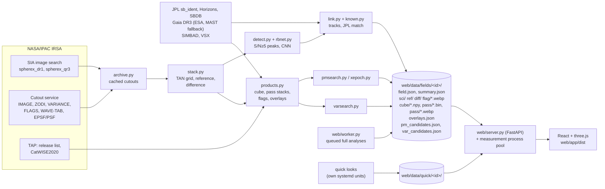

# SPHEREx Sky Change: technical document

NASA Space Apps 2026, challenge *Planet X and SPHEREx*. This document is for judges and engineers who want to know
how the tool and its analysis pipeline work. Every method, file name and number below comes from the repository;
paths are relative to the project root. Where the code and a document disagree, this text says which it follows.

> **The short version.** Type a sky position or an object name. The tool downloads every SPHEREx image of that patch
> from IRSA, puts them on one grid and plays them in time order, with difference images, per-pass stacks, flags,
> catalogue overlays and on-the-fly spectra. Behind that, a pipeline looks for asteroids (difference images, a
> self-trained real/bogus CNN, track linking, JPL matching), distant bodies (parallax between survey passes),
> moving stars, variable stars and cold brown dwarfs. **No discovery is claimed.** AI candidates and visitor votes
> are not discoveries.

## Contents

1. [Overview and architecture](#1-overview-and-architecture)
2. [Pipeline stages](#2-pipeline-stages)
3. [On-demand measurement APIs](#3-on-demand-measurement-apis)
4. [Front end](#4-front-end)
5. [Validation summary](#5-validation-summary)
6. [Limitations and honesty notes](#6-limitations-and-honesty-notes)
7. [Reproducing, and credits](#7-reproducing-and-credits)
8. [The in-site assistant: retrieval, training data and fine-tuning](#8-the-in-site-assistant-retrieval-training-data-and-fine-tuning)

---

## 1. Overview and architecture

### 1.1 What the system does

| Part | Purpose | Main code |
|---|---|---|
| Data access | IRSA SIA search, cutouts, PSF, flags, wavelength per pixel | `sxlib/archive.py` |
| Field pipeline | align, reference, difference, detect, CNN, link, JPL match, products | `sxlib/stack.py`, `detect.py`, `rbnet.py`, `link.py`, `known.py`, `analyze.py`, `products.py` |
| Star science | proper-motion search, cross-epoch motions, variable search, brown-dwarf classifier | `sxlib/pmsearch.py`, `xepoch.py`, `varsearch.py`, `specclass.py` |
| Quick look | any position playing within about a minute, then the same lab products | `sxlib/quicklook.py`, `web/quick.py` |
| Web backend | FastAPI routes, job queue, measurement worker pool | `web/server.py`, `web/api_*.py`, `sxlib/measure.py`, `sxlib/starcheck.py` |
| Analysis worker | full analyses requested from the site, one at a time | `web/worker.py` |
| Front end | React 19 + Vite + three.js single-page app, zh-Hant/en | `web/app/src/` |

### 1.2 Data flow



### 1.3 Per-field products

A full analysis (`sxlib/analyze.py: analyze_field`) writes into `web/data/fields/<id>/`:

| File | Content |
|---|---|
| `field.json` | field centre and size, TAN WCS, per-exposure metadata (time, detector, release, wavelength, α, reference count, coverage, flag fractions), every stored candidate (`p ≥ 0.05` or catalogue-matched), tracks, known bodies, blind-link and static-veto annotations, products index |
| `summary.json` | small record for the home page and `/api/fields` |
| `sci/`, `ref/`, `diff/NNNN.webp` | lossless 8-bit frames. Science and reference share an asinh stretch per detector; the difference frame encodes S/N as `128 + 16·S/N` |
| `flag/NNNN.webp` | RGBA contamination overlay per exposure (saturated, persistence, ghost, outlier, other unusable) |
| `cube/img.npy`, `var.npy`, `flag.npy`, `lam.npy` | every exposure on the field grid: float16 flux and variance, uint8 flag code, wavelength map kept every 5th pixel. These feed the on-demand APIs |
| `pass/stacks.bin` | float16 `[pass][7][n][n]` median stacks with a 16-byte header: band 0 is all detectors, bands 1–6 are D1–D6 |
| `pass/stacks_g{k}.bin` | the same, one file per band group, so the lab downloads only what it shows |
| `pass/p{k}_d{d}.webp` | 8-bit previews of each stack (one shared stretch per band) |
| `pass/flags.bin` | per pass, the flags carried by at least a share of its exposures at each pixel |
| `overlays.json` | Gaia DR3 (G < 19) and CatWISE2020 (W2 < 17) sources in field pixels, with catalogue epoch and motion in px/yr |
| `pm_candidates.json`, `var_candidates.json` | outputs of the proper-motion and variable-star searches |

A finished quick look (`web/data/quick/<id>/`) writes the same lab files plus `preview.json` and its own frame
folders, so every lab tool works on any position. A quick look's `field.json` has no CNN candidates or tracks.

### 1.4 Server, worker and deployment

* **Web server** (`web/server.py`): FastAPI app that serves the built front end (`web/app/dist`), the data folder
  (`/data`) and the APIs. It sets cache headers (hashed bundles are cached for a year, JSON and HTML are revalidated)
  and security headers, including a CSP built from hashes of the inline scripts. Feature modules
  `web/api_*.py` (Gaia star card, asteroid follow, NEOSSat, comet) are added through their `router`.
* **Measurement pool**: the numpy work for `/point`, `/probe` and `/starcheck` runs in a `ProcessPoolExecutor` of
  spawned workers (`SX_MEASURE_WORKERS`, default 8, each pinned to one BLAS thread). Limits: 4 requests in flight
  per visitor and 64 overall, after which the server answers HTTP 429. A worker that crashes gets one fresh pool
  and one retry.
* **Full analyses** (`POST /api/jobs`): the server checks the request and writes `var/queue/<time>_<id>.json`.
  `web/worker.py` takes the oldest job, runs `analyze_field` and keeps `var/jobs/<id>.json` up to date. A job left
  `running` by a restart goes back to the head of the queue. A refresh is built as `<id>.new` and swapped in only
  when complete.
* **Quick looks** (`POST /api/quick`): each runs as its own transient `systemd-run --user` unit (memory cap 6 GB),
  or as a detached process when there is no user systemd. That way a restart of the web service does not kill them.
  The server also enforces per-visitor and running limits, a disk check, and pruning by count and size budget.
* **Updates**: `scripts/update_fields.py` asks `/api/field/<id>/fresh` whether IRSA has newer exposures and queues
  `/refresh`. It is meant for the weekly `deploy/spherex-update.timer`. `archive.collections()` asks IRSA's TAP
  once a day which `spherex_qrN` / `spherex_drN` releases exist, so a new release is used without a code change.
* **Deployment**: one cloud VM with a GPU. The GPU is only needed for training; the web app runs on CPU.
  `deploy/vm_setup.sh` installs Python 3.12, a virtualenv and nginx on port 80, which forwards to uvicorn on
  `127.0.0.1:8791`, and sets up the web and worker services and the weekly update timer (`deploy/spherex-update.*`,
  with the VM's project path filled in). `deploy/push.sh` runs on the development machine after
  `npm run build` (from Git Bash or WSL on Windows). It sends the project as a tar stream over the cloud provider's SSH
  (leaving out `.venv`, `node_modules`, `cache`, `var`, logs and training artefacts), installs `requirements.txt` on
  the VM, restarts both services and checks the HTTP status. The VM keeps its own virtualenv, image cache and running
  quick looks.

---

## 2. Pipeline stages

### 2.1 Download and reprojection (`sxlib/archive.py`, `sxlib/stack.py`, `sxlib/pipeline.py`)

* **Search**: IRSA SIA (`POS=circle ra dec r`, `COLLECTION` = every science release IRSA lists, falling back to
  `spherex_dr1` + `spherex_qr3`). Only `dataproduct_subtype == science` is kept. When several releases serve the same
  `(obs_id, detector)`, the newest processing wins (DR ranks above QR, then by number).
* **Cutouts**: a 1.5× larger cutout is requested, because the detector frame is rotated. The image is
  `IMAGE − ZODI`, plus `VARIANCE` and `FLAGS`. The per-pixel wavelength comes from the `WAVE-TAB` WCS (key `W`),
  sampled every 8 px and interpolated. For DR1/QR3 the effective PSF (`EPSF` table: zones × 33 × 33 at 5×) is stored
  once per calibration file. Older QR2 files carry an optical PSF cube instead. `load_psf` puts both on one 101×101,
  10× grid. Cutouts are cached as `.npz` (atomic writes). Retries use jittered exponential back-off.
* **Reprojection**: `Field.add` resamples image, variance and wavelength (bilinear, `reproject_interp`) and flags
  (nearest neighbour) onto one TAN grid of **6.15″ pixels** (odd size, centred on a pixel). Coverage is eroded by
  3 px, the residual background (median of good pixels) is removed, and exposures covering under 5% of the field are
  dropped.

### 2.2 Flags

From the L2 `FLAGS` header (names read from the `MP_*` keywords):

* **Hard-bad mask** (`HARD_BAD`): bits 0, 1, 2, 4, 5, 6, 9, 10, 11, 14, 15, 17, 26, 28 (transient, overflow, hot,
  persistence, non-linear and others), plus uncovered pixels.
* **Kept as features, not masks**: SOURCE (21), GHOST (22–24), OUTLIER (19), with OVERFLOW and PERSIST also recorded
  so a display can say why a pixel is unusable.
* Each exposure stores the share of covered pixels carrying each flag (`flag_frac`), which the players show.
  `products.flag_code` packs a per-pixel code: 1 unusable, 2 catalogued source, 4 ghost, 8 outlier, 16 saturated,
  32 persistence.

### 2.3 Reference and difference images (`Field.reference`, `Field.difference`)

* **Reference**: a per-pixel median of exposures from the same detector that are at least 3 h away in time (so a
  mover has left) and whose wavelength *at that pixel* is within a fractional tolerance. The full analysis uses
  `lam_tol = 0.03` (`analyze.REF_KW`); the function default is 0.02. Up to 36 candidates closest in wavelength are
  considered. Reference variance is `(π/2)·var/n` for n ≥ 3.
* **Scaling**: `α = median(sci/ref)` over bright reference pixels (S/N > 30, at least 20 of them), clipped to
  0.7–1.4.
* **Difference S/N**: `(sci − α·ref) / sqrt(var_sci + α²·var_ref + (0.1·α·ref)²)`. The 10% systematic term
  accounts for the undersampled PSF and uses the **reference** flux only. An earlier `max(sci, ref)` version capped
  real movers at S/N ≈ 10 (`README.md`).

### 2.4 Detection (`sxlib/detect.py`)

* Local maxima of the difference S/N (5×5 footprint) with **S/N ≥ 5**, away from the edges, with a sub-pixel centroid
  from the positive 3×3 difference.
* CNN input: **4 × 21 × 21 stamps** (about 2.2′), channels `sci`, `ref`, `snr` (each in noise units, `asinh(x/3)`)
  and a binary catalogue-source/ghost mask.
* The L2 `MP_OUTLIER` bit is **deliberately not a CNN input**. It fires on real movers but never on injected ones,
  so it would teach the network a simulation-only shortcut. It is stored per candidate (`l2`) and shown as separate
  evidence.

### 2.5 Real/bogus CNN (`sxlib/rbnet.py`, `scripts/make_dataset.py`, `scripts/train_cnn.py`)

* **Architecture**: three conv blocks (32/64/128 channels, two 3×3 conv + BatchNorm + ReLU each, max-pooling
  21→10→5), then global mean and max pooling, and a 256→128→1 head with dropout 0.3. About 0.3 M parameters.
* **Training data**: synthetic movers injected into real exposures with the exposure's own oversampled PSF
  (`sxlib/inject.py`: linear asteroid-like movers and distant parallax bodies). "Bogus" means every other S/N ≥ 5
  detection in the training fields. Real known asteroids are **never** used in training; they are a sim-to-real
  test set.
* **Split by field, never by candidate**: test fields `ecl180+00`, `ecl060+00`; validation fields `ecl120+00`,
  `ecl315-12`; `kb_*` (bright known-asteroid benchmark) fields are evaluation only. Bogus is capped at 50,000 per
  field. Per `paper_evidence/evidence.json → dataset_totals`: training 12 fields (12,351 injected, 716,736 bogus),
  validation 2, test 2, benchmark 15.
* **Training**: AdamW (lr 1e-3, weight decay 1e-4), OneCycle schedule, 30 epochs by default, random 90° rotations and
  flips, BCE with a positive-class weight. Temperature scaling is fitted on validation; the threshold is the logit at
  1% false-positive rate on validation.
* **`models/metrics.json`** (the model file's own metrics): temperature 0.780, threshold logit 0.395 (probability
  ≈ 0.597, the same as `evidence.json → threshold_prob`).

| `models/metrics.json` | CNN | S/N alone |
|---|---|---|
| Held-out test fields, injected + known vs bogus: AUROC | 0.992 | 0.718 |
| Recall at 1% FPR (all reals) | 0.950 | 0.081 |
| Known asteroids vs test-field bogus: AUROC | 0.986 | 0.514 |
| Test set at the validation threshold: recall / FPR | 0.949 / 0.94% | – |

`metrics.json` counts 723 known-asteroid detections in 29 fields. The headline numbers in `README.md` and the
paper come from `paper_evidence/evidence.json`, which counts 755 in 31 fields (pooled AUROC 0.985) and has a
**clean split**: 556 detections in 19 fields never used for training, **AUROC 0.987** (95% CI 0.981–0.992) against
0.537 for S/N alone, recall 90.8% at FPR 1.15%. The two files come from different evaluation runs; the evidence file
is the one cited.

At inference (`Scorer`) the model loads `models/rb_cnn.pt`, divides logits by the temperature and uses CUDA when
available. Candidates with `p ≥ 0.05` are stored for display, and `p ≥ 0.5` (`P_LINK`) are used for linking.

### 2.6 Track linking (`sxlib/link.py`, `sxlib/analyze.py: build_tracks`)

1. **Distant-body (parallax) search first**, on the confident, catalogue-unmatched detections (skipped when there
   are ≥ 4000 of them). Order matters: a body at a few hundred au drifts 1–3″/h within a pass and would otherwise be
   chopped into slow "asteroid" tracks.
2. **Static-residual veto** (`static_repeaters`): a detection with neighbours within 1.6 px over more than 1.5 days in
   at least 3 half-hour epochs is left out of fast linking. Nothing moving at ≥ 0.5″/h stays put that long.
3. **Fast movers per survey pass** (`link_linear`): pairs of detections set a constant sky velocity (0.5–300″/h,
   span ≤ 3 d). A track needs **≥ 4 detections in ≥ 3 distinct 30-minute epochs within 8″**. It is refit by least
   squares, and tracks without significant motion are rejected. These defaults were tuned on the 65 Cybele field.
4. By default catalogue-matched detections join linking whatever their score, so known objects are shown.
   `annotate()` reruns linking **blind** (AI score only) and marks every track `blind: true/false`, storing what blind
   linking finds in `doc["blind_link"]`.

### 2.7 JPL matching (`sxlib/archive.known_small_bodies`, `sxlib/known.py`)

* Exposures are grouped into 0.5-day clusters, and each is queried against **JPL Small-Body Identification**
  (`sb_ident`, asteroids and comets, V ≤ 21.5, geocentre). Positions are linearly propagated with the returned rates.
  Detections within 2 px of a predicted position get its name, and a track takes the majority name.
* **Astrometry check** (`jpl_residuals`): for every named track, **JPL Horizons** positions are computed *as seen from
  the SPHEREx spacecraft* (Horizons ID −163182) at each detection time. A track is `consistent` when at least 75% of
  its detections are within 5″. README reports a median offset of about 0.6″ (0.1 px).

### 2.8 Distant-body parallax search (`link.search_distant`, `link_groups`, `fit_distant`; `sxlib/shiftstack.py`)

* Detections are split into passes (`round(Δmjd/90)`). Within a pass, groups form either as **stationary groups**
  (≥ 3 detections, ≥ 2 epochs, within 8″) or as slow straight tracklets (≤ 15″/h).
* For each trial distance (30–3000 au, log grid), groups in other passes are predicted with Earth's barycentric
  parallax plus a linear orbital drift. The drift is **capped at escape speed** (√2 × circular rate), which is what
  separates distance from motion. The best combination with at most one group per pass is kept, and **≥ 3 passes**
  are required: with two passes any offset can be explained by some drift.
* Partial tracks are absorbed and merged. A curvature allowance covers departure from a straight drift (about 30″ at
  50 au over a year). `distance_profile_ratio` flags ambiguous distance fits.
* `sxlib/shiftstack.py` adds shift-and-stack for bodies too faint for single exposures: difference S/N frames of a
  pass are shifted along the predicted parallax path per trial distance and summed, and the stacked peaks are linked
  with the same `link_groups`.
* The demo field `planetx` contains a **simulated** body (`planet_x_injection`: 420 au, AB 15.5, circular orbit),
  and tracks that follow it are labelled `simulated: true`.

### 2.9 Proper-motion search (`sxlib/pmsearch.py`, `sxlib/xepoch.py`, `scripts/pm_search.py`)

* **Pass-to-pass (blind)**: detect and Gaussian-fit sources in the first and last pass stacks (a saturated core is NaN,
  so the fit uses the wings) and register the passes on the bulk of stars. Significance = shift / (fit error +
  systematic floor from bright stars). The shift must appear in the same direction in **at least two detector
  arrays**, because a blend of two stars of different colour moves its centroid when the band mix changes. There
  are also a vacated-position test and a straight-line test through intermediate passes. Only then do Gaia DR3 and
  CatWISE2020 *label* the candidate as known, static (likely artefact) or new.
* **Cross-epoch**: SPHEREx positions against CatWISE2020 (epoch about 2015.4, a baseline of about 10.5 yr). Each pass
  is registered to Gaia stars moved to its epoch (affine; Gaia fixes the frame and never selects). A candidate needs
  ≥ 5σ and ≥ 0.08″/yr, agreeing passes, agreement across ≥ 2 detectors, no saturation, and **isolation** (no
  comparable catalogue source within 3 px).
* **Joint fit**: position + proper motion + parallax for every candidate. VALIDATION.md explains why **no parallax is
  claimed**.

### 2.10 Variable-star search (`sxlib/varsearch.py`, `scripts/var_search.py`)

* Every exposure of a source is at a different wavelength (linear variable filter), so raw fluxes mix spectrum and
  time. Per detector the search fits **F(λ, t) = S(λ) × L(pass)**, with S a low-order polynomial in ln λ. The fit is in
  flux, without per-point S/N cuts (those bias the noisier pass upwards), with sigma clipping, and with zero points
  calibrated on the field's own stars.
* Sources are blind peaks of the all-pass stack. High-proper-motion stars are followed pass by pass. Blended
  (neighbour within 5 px) and extended sources are excluded.
* Photometry uses a 2-px aperture, or for cores saturated in ≥ 40% of exposures, a 3-px-wide **ring in the PSF wings**.
* A candidate needs a significant change that agrees in at least two detectors. VSX and Gaia only label it.

### 2.11 Brown-dwarf spectral classifier (`sxlib/specclass.py`, `scripts/train_specclass.py`)

* **Input**: the spectrum binned into 16 log-spaced bins over 0.74–5.0 µm (median per bin, points with flux > 3σ),
  encoded as log₁₀ flux relative to the brightest bin plus a 16-value mask. At least 5 bins are required.
* **Model**: a small MLP (32 → 64 → 32 → 1, ReLU) whose weights are in `models/bd_spec.npz`. Inference is plain numpy,
  so the web server does not need PyTorch.
* **Training**: 60,000 **synthetic** spectra, 50% T/Y dwarfs (blackbodies with methane, water and CO bands of random
  depth). The negatives are ordinary and reddened stars, M giants and Miras (hard negatives with deep water bands),
  L dwarfs, young stars with dust excess and galaxies. Neighbour light, noise and missing bands are added. No real
  data is used in training.
* **Test on real SPHEREx spectra**: Epsilon Indi B and WISE 0855 as positives, and 420 Gaia stars in the analysed
  fields as negatives (numbers in §5). The score is shown on clicked spectra, targets and movers.

### 2.12 Gaia and CatWISE overlays (`sxlib/products.overlays`, `sxlib/gaia.py`)

* **Gaia DR3**: queried at ESA's Gaia archive first, then MAST's Gaia DR3 TAP, then MAST's catalog cone service, with
  one output format whichever answers. Sources with G < 19 are kept, at most 4000.
* **CatWISE2020**: IRSA TAP `catwise_2020`, W2 < 17, at most 4000.
* Each source is stored in field pixels with its catalogue epoch (Gaia J2016.0, CatWISE 2015.4) and its motion in
  px/yr, so the front end can **carry each source to the epoch of every pass**. The Gaia star card
  (`/api/gaia/star`) moves positions to the image epoch before matching.

---

## 3. On-demand measurement APIs

All three run in the measurement process pool (§1.4) and read the field's `cube/*.npy` through memory maps. Caches are
keyed on file modification time, so a re-analysed field is re-read. They work on analysed fields and on finished quick
looks (`_fdir` resolves either).

### 3.1 `GET /api/field/{id}/point?x=&y=` (`sxlib/measure.point`)

**What it does**: forced aperture photometry at field pixel (x, y) in **every exposure**. The aperture radius is 2 px,
the sky is the median of a 5–9 px annulus, and pixels flagged unusable are excluded. The aperture is rejected if under
75% of it is usable or the annulus has fewer than 20 pixels.

**Returns**: `points[]`, one per exposure, with time, detector, the wavelength at that pixel, flux and error in µJy
(or null) and the flag code. Since each exposure samples its own wavelength, the list is both a **light curve** and an
**on-the-fly spectrum**. The response also carries `bd_score`, the brown-dwarf classifier on the points not flagged
bad or ghost.

**Limits**: a fixed small aperture on a 6.15″ undersampled grid, so neighbours within a few pixels contaminate it.
Saturated cores come back as null points. The spectrum mixes all passes, so a variable star's spectrum is blurred by
its variability.

### 3.2 `GET /api/probe?field=&x=&y=&i=` (`sxlib/measure.probe`, analysed fields only)

**What it does**: asks what can be said about the spot in exposure *i*.

**Returns**:

* `here`: the nearest stored detection within 3 px in that exposure.
* `track`: its track, with kind, known name, distance or rate.
* `same_spot`: how many confident detections sit within 1.5 px and in how many passes. A fixed source lights up in
  several passes.
* `source`: the blackbody fit from `universe.json`, when that file exists.
* `distant`: for a confident, unmatched detection, whether the field's **blind distant-body search** (cached on disk
  under `var/measure/`) already put it on a track. If not, a seeded parallax + bound-orbit search
  (`link.probe_distant`) runs, giving distance, drift, rms and passes, or a reason why not.

**Limits**: it starts only from detections the difference pipeline made. Fewer than 3 passes cannot separate distance
from orbital motion.

### 3.3 `GET /api/field/{id}/starcheck?x=&y=` (`sxlib/starcheck.check`)

This answers whether a bright spot is a star. It is used by the control room's click-a-star panel and by the lab.
Steps:

1. **Median of all exposures** in a 19×19 stamp, with unusable pixels set to NaN. Detector artefacts, cosmic rays and
   ghosts do not stay on one sky position, so they drop out. The click snaps to the brightest pixel within 2 px.
2. **Signal-to-noise** of the peak against a robust sky in a 5–9 px annulus. Below 5 the verdict is `none`.
3. **Point-source (PSF) model**: a round Gaussian + flat sky fitted to the 7×7 pixels. Its FWHM is compared with the
   **field reference width**, the median fitted FWHM of up to 25 isolated, unsaturated, S/N ≥ 20 Gaia stars in the
   same field (at least 3 are needed). Ratio > 1.6 gives `extended` (galaxy, nebula, blend); < 0.55 gives `sharp`
   (more like a bad pixel). The radial profile within 5 px is returned for plotting against the model.
4. **Per-exposure presence**: the 3×3 sum minus sky against its noise in each exposure, with > 3σ counting as present.
   It returns `present`, `usable` and a time-ordered string `seq` (1 present, 0 absent, – unusable). With ≥ 5 usable
   exposures and presence under 50%, the verdict is `transient`.
5. **Flags**: the shares of exposures where the pixel is saturated, ghost or persistence. Saturated in more than 30%
   gives the verdict `saturated` straight away.
6. **Catalogue match**: Gaia or CatWISE within 1.5 px after carrying positions to the mean observation time, with the
   magnitude and, for Gaia, the motion in ″/yr.
7. **Spectral fit** (for `star`, `extended`, `unfit`): forced photometry in every exposure, binned into 60
   log-spaced bins over 0.75–5 µm. A **blackbody** grid (2300–40,000 K) is compared with a **power law** (β from −3
   to 3); `galaxy` is reported if the power law's reduced χ² is below 0.7× the blackbody's. For a star, a rough
   distance follows from assuming a main-sequence radius ∝ T^1.6. The brown-dwarf score is added.
8. **CNN detections nearby**: every stored detection within 2 px in any exposure, with its probability, the count
   above `p_link`, the maximum, and the track if one exists.

**Verdicts**: `star`, `extended`, `sharp`, `transient`, `saturated`, `unfit`, `none`.

**Limits, stated in the code and on the page**:

* **The CNN only sees difference-image detections.** A static, steady star subtracts away, leaves nothing to detect,
  and so the AI panel is empty. That is expected and does not count against the star. Quick looks have no CNN
  candidates at all.
* A round Gaussian on a 7×7 window of an undersampled PSF is a coarse shape test. The width ratio needs at least 3
  good reference stars or the verdict is `unfit`.
* The temperature is a pure-blackbody fit with no extinction. The distance assumes a main-sequence star and is a rough
  order of magnitude.
* The catalogue match is positional only (1.5 px ≈ 9″).

---

## 4. Front end

### 4.1 Stack and routes

React 19, Vite 6 and three.js 0.180 (`web/app/package.json`), with no UI or animation library. Routing uses the hash
(`web/app/src/main.jsx: parseHash`), and every page is a lazily loaded chunk wrapped in an error boundary. Front-end
errors are reported to `POST /api/clienterr` (message, stack and route only, at most 5 per page load).

| Route | Page |
|---|---|
| `#/` | home: search on the first screen + the 3D cosmos (`landing.jsx`, `cosmos/`) |
| `#/sky/<ra dec or name>` | quick look player (`skyresolve.jsx`, `quick.jsx`) |
| `#/field/<id>`, `#/field/<id>/track/<n>` | viewer of an analysed field; object page of a track |
| `#/lab/<id>` | field lab: blink / one pass / add / subtract, D1–D6, false colour, flags, overlays, click for spectrum |
| `#/targets`, `#/target/<id>` | the challenge's five named targets |
| `#/movers` | public review queue: blink first/last pass, vote real / artefact / not sure, practice mode |
| `#/guide[/<section>]` | how to read the images, validation, limits, requirement checklist |
| `#/follow/<object>`, `#/comet` | follow one asteroid/comet through every SPHEREx image (IRSA MOST); comet page |
| `#/universe/<id>`, `#/story`, `#/features`, `#/discovery` | 3D "universe" of a field and explanatory pages |
| `#/credits` | data and asset credits |
| `#/embed/<pos>` | player without page chrome for an `<iframe>` |

The query forms `/?ra=…&dec=…`, `/?target=…`, `&fov=0.15|0.3|0.6`, `&embed=1` and `&v=&d=&k=` are rewritten into the
hash (`queryToHash`), and WiseView-style `#ra=…&dec=…&size=…` links are accepted too.

### 4.2 The 3D home (`cosmos/scene.js`, `cosmos/Cosmos.jsx`)

A zoom journey in four stages driven by scroll or pinch, with progress `p` from 0 to 3.5. At each stage boundary the
picture fades through black.

0. **Milky Way**: a procedural spiral (70,000 stars, 22,000 in lite mode) with the Sun marked.
1. **Solar System**: planets on circular mean orbits. A time dial moves the planets, the Sun direction, the SPHEREx
   orbit plane and the day's scan circle.
2. **Earth and SPHEREx**: a dawn-dusk polar orbit (drawn higher than real so it can be seen) with the telescope looking
   straight out. The Earth texture is NASA Blue Marble Next Generation, with procedural clouds on top. The spacecraft
   starts as a simple procedural model and is swapped for **NASA's WIRE glTF model** (`/cosmos/wire_nasa.glb`, Draco)
   when that loads (see §6).
3. **The SPHEREx sky**: an equirectangular false-colour image made by `scripts/build_cosmos_sky.py` from the IRSA
   SPHEREx DR1 all-sky HiPS (1.10, 2.19 and 3.38 µm as blue, green, red), with markers for analysed fields and targets
   and the day's scan circle. Zooming in further dives into a random measured field and opens `FieldView.jsx`. That
   component shows one real 0.3° field with a camera choice (all detectors or D1–D6), half-year stacks or single
   exposures, a "what changed" mode, and marks showing how each verdict was reached.

Other textures are procedural, and shaders and textures are compiled and uploaded up front to avoid hitches mid-zoom.

### 4.3 The control room (`cosmos/room.js`, `cosmos/RoomView.jsx`)

Clicking SPHEREx at stage 2 "enters the telescope". This is a **stylised** walkable room (WASD, arrows, drag to look,
click the floor to walk) with three things to use:

* **The window** shows the real per-pass SPHEREx stacks of the chosen field (`/data/fields/<id>/pass/p{k}_d{d}.webp`),
  composed on a 2D canvas in the page:
  * **Band selection D1–D6** (the UI labels them 0.75–1.09, 1.10–1.62, 1.63–2.41, 2.42–3.82, 3.83–4.41,
    4.42–5.00 µm). One band is shown in grey; several merge into colour, shortest wavelength blue and longest red.
  * **Raw / enhanced**: raw is the preview stretch as stored. Enhanced subtracts a grey level and raises contrast
    (`(v − 36) × 1.3`) and changes the display only.
  * The field is placed far outside the glass and shown magnified, with an additive blend and a radial fade.
* **The time lever** on the sill (or a slider) steps through the passes, with crossfades between them.
* **Click a star** calls `/api/field/<id>/starcheck` (§3.3). The panel shows the profile against the model, the
  per-exposure presence strip, the spectrum with its blackbody colour, the AI detections bar with its threshold, and
  Gaia/CatWISE badges. A moving star also gets a ring at its current position, dots for each pass and an arrow drawn
  10× longer than the real shift (the page says so).
* **The computer** opens the same `FieldView` as the home page zoom.

Rendering choices:

* **GPU detection** (`canvas.js: gpuOK`): WebGL with `failIfMajorPerformanceCaveat`, and the renderer string is checked
  for SwiftShader, llvmpipe and similar. Software rendering gets the **lite** path: pixel ratio 0.6, fewer stars, no
  antialiasing, rendering only when something moves, and no shadows or bloom in the room. Without WebGL at all, the
  home page shows a still sky picture with a "Try 3D" button.
* **Float-buffer fallback**: bloom (`UnrealBloomPass`) and the reflection maps (PMREM from `RoomEnvironment` and an HDR
  studio) need float colour buffers. The room checks `EXT_color_buffer_float` / `half_float`. On phones (coarse pointer
  or a short side under 600 px), and above all iOS Safari, which has drawn the reflection maps black, it **always**
  takes the plain path: no environment maps, metalness lowered so metal does not go black, stronger hemisphere light,
  no bloom, no shadows, and no extra prop models.
* **Black-frame watchdog**: at frames 30 and 150 the room reads 49 pixels back with `readPixels`. If they are all
  near black, it hands over to the lighter version. If that is black too, the 3D view is dropped and the panels keep
  working. A `webglcontextlost` event is handled the same way.
* **One WebGL context at a time**: entering the room tears down the cosmos scene (`destroy()` →
  `renderer.dispose()` + `forceContextLoss()`), and leaving rebuilds it at the Earth stage.
* **Music**: two original tracks by the team. They are off by default (remembered in `localStorage`) and fade in and
  out.

### 4.4 Internationalisation

`web/app/src/i18n/` has a custom JSX runtime with two ways to write text: Chinese source strings translated from
`catalog.js`, or `L('中文', 'English')` with both inline. English is the default interface; Traditional Chinese is
used when chosen or requested with `?lang=zh-Hant`. The English catalogue is loaded only when needed.
`scripts/audit_i18n.mjs` fails the tests if any Chinese string lacks an English version.

### 4.5 Tests

| Command | What it checks |
|---|---|
| `cd web/app && npm test` | `test_sky.mjs` (position parsing: decimal, sexagesimal, invalid), `check_refs.mjs` (no identifier used without being defined), `audit_i18n.mjs` (every Chinese string has English), `audit_css.mjs` (design tokens only) |
| `npm run build` | Vite build, then `scripts/check_dist.mjs` fails if required files (media, paper pages, evidence JSON) are missing |
| `npm run check` | all of the above plus pytest |
| `.venv/bin/python -m pytest tests -q` | static-residual veto, proper-motion search, cross-epoch, variable search, ePSF handling, Gaia access, follow, NEOSSat, shift-and-add, web headers, measurement endpoints, client errors, validation endpoint |
| `tests/e2e/` | browser tests: every challenge requirement in the English UI, accessibility, page budget, visual rules |

---

## 5. Validation summary

Full tables: [`VALIDATION.md`](../VALIDATION.md), regenerated by `scripts/write_validation_md.py` from the files the
site serves (`/api/validation`). Asteroid-pipeline numbers come from `paper_evidence/evidence.json` and `README.md`.

**Asteroids (CNN)**

* Real known asteroids, clean split: AUROC **0.987** against 0.537 for S/N alone, with recall 90.8% at 1.15% FPR.
* Injected movers on held-out fields: AUROC 0.992.
* 50% per-exposure completeness at AB 17.3.
* Astrometry against Horizons seen from SPHEREx: median about 0.6″.
* 65 Cybele field: 7 tracks are displayed, but 3 of them are only linked with catalogue help; blind linking finds 4.

**Distant bodies**

* Injected bodies at 500–3000 au *with* orbital motion: **47/48** recovered in three-pass fields, **0/12** in the
  two-pass field (by design).
* An earlier 59/60 result injected and fitted bodies without orbital motion. It was circular and has been replaced.
* No real distant body is reported.

**Proper motions (blind, pass-to-pass)**

* Barnard's Star 10.52″/yr (catalogue 10.39), Epsilon Indi B 4.33 (4.68), WISE 0855 7.03 (8.15). All three are found
  without being told where to look.
* 0 false alarms across 9 fields.
* On **45 random Gaia high-proper-motion stars**, found per proper-motion bin: 0.5–1″/yr **1/15**, 1–2″/yr **6/15**,
  ≥ 2″/yr **12/15**. Median astrometric error 0.397″ (90th percentile 0.806″).
* `REQUIREMENTS.md` notes that after the switch to DR1 + QR3 the same 45 stars are found 19 times, against 25 on
  QR2 + QR3, and the median error rose from 0.27″ to 0.40″. **The cause is not yet known.**

**Cross-epoch against CatWISE**

* Scatter 13.8 mas/yr per axis on isolated stars; 0 false alarms among 1300 static stars.
* Injected motion is recovered 51% of the time at 0.1″/yr and 87% at 0.2″/yr.
* Only **50% of sources are isolated enough** to be searched.
* Real Gaia movers found: 2 of 4 above 0.15″/yr and 2 of 28 at 0.05–0.1″/yr.
* **No parallax is claimed.** Static stars scatter 70–135 mas, Epsilon Indi B gives 183 ± 105 mas (catalogue 271), and
  the value depends on registration (102–297 mas). An earlier 304 ± 71 mas figure was withdrawn.

**Brown-dwarf classifier**

* Synthetic validation: accuracy 0.969, AUC 0.992.
* Real positives score 1.000 (Epsilon Indi B) and 0.999 (WISE 0855). **Only two real positives exist.**
* 420 real Gaia stars: median score 0.0, false-positive rate 0.5% at 0.8. `bd_spec_metrics.json` lists two of these
  stars scoring ≥ 0.99.

**Variable stars**

* R Dra is flagged (×1.90, 5.9σ) and RW Aur is flagged (×1.23, 7.85σ). The Barnard control is not flagged (×1.04).
* 927 stars were searched and 2 candidates found, both catalogued variables.
* Completeness: of 194 catalogued variables in the fields, 40 could be searched and **2 were flagged**.
* The saturated-star threshold (×1.30) was **set on these same fields**, so the control is not independent. No
  unsaturated real variable has been recovered yet.

**R Dra phase**

* Against the VSX ephemeris (period 246.12 d), the order of brightness agrees with the phase.

**Saturated-star photometry**

* The Barnard's Star control (steady star) gives max/min pass ratios of 1.05–1.37 with the PSF-wing ring.
* The SPHEREx PSF fit was worse on saturated stars (up to 2.04) and was rejected for them.

**Static-residual veto**

* Unidentified fast tracks: R Dra 14 → 0, Epsilon Indi 21 → 0, Barnard 2 → 0.
* Cybele went 1 → 2 and Taurus 0 → 1.

---

## 6. Limitations and honesty notes

* **No discovery is claimed.** The site has not discovered a new planet or any new object. CNN candidates, "new"
  labels in the movers queue and visitor votes are prompts for a closer look, not discoveries. The distant-body
  result is a non-detection with limits.
* **The simulated Planet X** in the `planetx` field is injected on purpose and deliberately bright (AB 15.5); a real
  one would need stacking. Its tracks are labelled `simulated`, and the field is built from QR2 and kept fixed.
* **The control room is stylised.** SPHEREx is an uncrewed space telescope, and the room is a way into the data, not
  a model of the spacecraft. The page and the code comments say so.
* **The window view** is a 0.3° field shown magnified, built from the **8-bit per-pass preview stacks**
  (`pass/p{k}_d{d}.webp`), not the float data. "Enhanced" changes the display only. The motion arrows are drawn 10×
  longer than the real shift.
* **The telescope model** on the home page is **NASA's WIRE model** (NASA 3D Resources) standing in, because no public
  SPHEREx 3D model exists. The stage caption and `#/credits` say so, and a procedural model is shown if it fails to
  load.
* **Injections**: injected sources add signal but not their own Poisson noise. `README.md` also notes that injections
  into QR3 exposures reused a QR2 PSF cube of the same detector. The current `sxlib/inject.py` can also sample the
  DR1/QR3 ePSF; which PSF went into the released training set is as `README.md` states. Known-object positions are
  linearly propagated within ±0.25 d of a JPL query.
* **Proper motions**: with SPHEREx alone a star must move about 0.7″/yr to be seen and is found reliably only above
  2″/yr. Slower motions need CatWISE and isolation. Recovery dropped after the DR1 switch, for reasons not yet known.
* **Photometry**: bright stars saturate. Ring photometry is good to about ×1.2, and the variable search, with 3–4
  passes, finds only large, slow changes and gives no periods.
* **The brown-dwarf model** has two real positives. A high score means "worth a look".
* **AI scope**: the CNN only scores point-like detections in difference images. It cannot judge static stars, and
  trails need the separate classical `sxlib/streak.py`. Quick looks run no CNN.
* **Quick looks** download 280–460 cutouts. First frames come within about a minute; a full 0.3° look takes several
  minutes and is slower when IRSA is busy.
* **No external AI service** is called by the running site. Most code and text were written with an AI coding
  assistant under the team's direction (`README.md`).
* **The in-site assistant is a 1B-parameter model.** It cites the papers it was given, but it can still state wrong
  facts, especially in answers marked "No source: general knowledge". Its answers are not checked by a person.
  Section 8 has the details.

---

## 7. Reproducing, and credits

### 7.1 Run locally (from `README.md`)

```bash
python3.12 -m venv .venv && .venv/bin/pip install -r requirements.txt      # + requirements-dev.txt for tests/figures
cd web/app && npm install && npm run build && cd ../..                     # build fails if required files are missing
SX_INSECURE=1 .venv/bin/uvicorn web.server:app --host 127.0.0.1 --port 8791   # SX_INSECURE=1 only behind TLS interception
.venv/bin/python -m web.worker                                             # runs queued full analyses, one at a time
```

Windows (PowerShell):

```powershell
py -3.12 -m venv .venv; .venv\Scripts\python -m pip install -r requirements.txt
cd web\app; npm install; npm run build; cd ..\..
$env:SX_INSECURE = "1"     # only behind TLS interception
.venv\Scripts\python -m uvicorn web.server:app --host 127.0.0.1 --port 8791
.venv\Scripts\python -m web.worker                                        # in a second terminal
```

Open `http://127.0.0.1:8791/`. With no data on disk the site still works: any position starts a quick look that
downloads from IRSA. Useful environment variables: `SX_CACHE` (cutout cache), `SX_MEASURE_WORKERS`,
`SX_JOBS_ENABLED`, `SX_QUICK_RUNNING`, `SX_MIN_FREE_GB`.

### 7.2 Rebuild data

Every script resolves its paths from the repository root (shared helpers in `scripts/_common.py`), so it runs from
any directory, as `python scripts/<name>.py` or `python -m scripts.<name>`. On Windows replace `.venv/bin/python`
with `.venv\Scripts\python` (and `python3` below with the same); `ffmpeg`, `pdftocairo` and `tectonic` are found on
`PATH` as `.exe`.

```bash
.venv/bin/python scripts/build_targets.py analyze      # the five challenge targets (~30 min each; a few hundred cutouts)
.venv/bin/python scripts/build_targets.py annotate     # lab products + predicted target positions, from cached cutouts
.venv/bin/python scripts/pm_search.py                  # proper-motion search on every analysed field (data on disk)
.venv/bin/python scripts/var_search.py                 # variable-star search (data on disk)
.venv/bin/python scripts/validate_pm.py --n 45         # random Gaia high-PM stars (downloads; hours)
.venv/bin/python scripts/external_checks.py && .venv/bin/python scripts/write_validation_md.py
.venv/bin/python scripts/build_cosmos_sky.py           # home-page sky texture from the DR1 all-sky HiPS
```

Model training and paper evidence (a GPU machine was used):

```bash
python3 scripts/make_dataset.py --out data/ds --procs 4    # ecliptic fields, injections + labels
python3 scripts/known_benchmark.py                         # bright known-asteroid benchmark (evaluation only)
python3 scripts/train_cnn.py                               # split by field; writes models/
python3 scripts/injection_recovery.py                      # completeness curves
python3 scripts/train_specclass.py                         # brown-dwarf classifier
python3 scripts/build_universe.py cybele planetx taurus     # 3D universe data
python3 scripts/planetx_grid.py && python3 scripts/build_paper_evidence.py
```

Tests: `cd web/app && npm test` and `.venv/bin/python -m pytest tests -q` (Windows:
`.venv\Scripts\python -m pytest tests -q`). Deployment: `deploy/vm_setup.sh` once on
the VM, then `deploy/push.sh` from the development machine after each build (§1.4).

### 7.3 Credits and licences

Project code: Apache-2.0 (`LICENSE`). Third-party software is listed in `NOTICE`. The site's `#/credits` page
(`web/app/src/credits.jsx`) lists:

**Data**

* **SPHEREx** via NASA/IPAC IRSA:
  * DR1 spectral images, [10.26131/IRSA678](https://doi.org/10.26131/IRSA678), the main data.
  * QR3, [10.26131/IRSA662](https://doi.org/10.26131/IRSA662), the images after DR1.
  * DR1 all-sky cube, [10.26131/IRSA679](https://doi.org/10.26131/IRSA679), the home-page backdrop.
  * QR2, [10.26131/IRSA652](https://doi.org/10.26131/IRSA652), only for the fixed simulated Planet X field.
  * The site quotes the SPHEREx and IRSA acknowledgement sentences and cites the canonical papers: Bock et al. 2026
    (mission), Akeson et al. 2026 (pipeline), Crill et al. 2025 (sky simulator), Korngut et al. 2026 (instrument and
    calibration).
* **Gaia DR3** (ESA/DPAC; Vallenari et al. 2023), with the Gaia acknowledgement.
* **CatWISE2020** (Marocco et al. 2021).
* **JPL** Small-Body Identification, Horizons, SBDB.
* **IRSA MOST**.
* **CDS**: SIMBAD, VizieR, Aladin Lite.
* **AAVSO VSX** via VizieR.
* **NEOSSat**: Canadian Space Agency, CADC, Open Government Licence – Canada.

**3D scene assets**

| Asset | Source and licence | Used for |
|---|---|---|
| Earth texture | NASA Earth Observatory, Blue Marble Next Generation (Aug 2004); public domain | Earth on the home page |
| Metal materials | ambientCG MetalPlates004/007/008, SheetMetal001; CC0 | room walls, floor, ceiling |
| HDRI and props | Poly Haven studio_small_09, metal_stool_01, modular_industrial_pipes_01, modular_electric_cables; CC0 | room lighting, stool, pipes, cables |
| Telescope model | NASA 3D Resources, Wide-Field Infrared Explorer (WIRE), standing in for SPHEREx | telescope orbiting the Earth |
| Music | original, by the team ("Mysterious Cosmos", "Interstellar Inspired") | home page and room |

This is a NASA Space Apps 2026 hackathon prototype, not an official product of NASA, the Canadian Space Agency or
any data provider.

---

## 8. The in-site assistant: retrieval, training data and fine-tuning

Every page has an **Ask** button, the control room has a robot guide, and the universe view can ask about the
selected object. All three send the same request to `POST /api/ask` (`web/api_ask.py`), which answers from indexed
papers plus the site's own measurements and streams the reply as server-sent events. The answering model is
**Meta Llama 3.2 1B Instruct, fine-tuned with LoRA** on dialogues written for this site. Everything below runs on the
project's own machines; no question is sent to an outside AI service, and question text is not logged.

### 8.1 How one question is answered

1. **Retrieval query.** The question, prefixed with the kind and name of what the visitor is looking at
   (for example `target Barnard's Star: how fast does it move?`).
2. **Retrieval.** The query is embedded with **BGE-M3** (BAAI, multilingual, 1024-d) and compared by cosine
   similarity with every passage in `llm/index/embeddings.npy`. The best 5 passages scoring at least
   `MIN_SCORE = 0.53` are kept.
3. **Site facts.** For a field or target, up to 1,500 characters of numbers from `web/data/fields/<id>/field.json`
   (exposures analysed, target measurement, known bodies, tracks), so the assistant can talk about what this site
   measured, not only about the literature.
4. **Prompt.** `build_messages` puts a system prompt (answer in the visitor's language, cite passages as `[n]`,
   say plainly when nothing was retrieved), the last 8 turns, then "Source passages", "The user is viewing",
   "Site facts" and the question.
5. **Generation.** vLLM serves the merged model (`spherex-assistant`) on the web VM's NVIDIA L4
   (`--max-model-len 8192 --gpu-memory-utilization 0.5 --max-num-seqs 16`), at temperature 0.3 and up to 512 tokens.
6. **Labelling.** The `done` event carries `grounded` (at least one passage passed the threshold). An ungrounded
   answer always gets the page label "No source: general knowledge", whatever the model wrote.

Limits: 10 questions per visitor per minute, 200 per day, 4 answers streaming at once. If the model server is down,
a canned answer that still lists the retrieved sources is streamed instead.

**Choosing the embedding model.** The first index used the English-only `bge-small-en-v1.5`. Chinese questions then
matched the wrong papers: for example, a Chinese question asking why brown dwarfs are easier to see in the infrared
retrieved only a Planet Nine paper. We scored 22 on-topic and 16 off-topic questions (half Chinese, half English)
against the index:

| embedding model | off-topic best score | on-topic best score | separates? |
|---|---|---|---|
| multilingual-e5-small | 0.77-0.85 | 0.81-0.91 | no, the ranges overlap |
| **BGE-M3** | **0.39-0.53** | **0.51-0.74** | yes, threshold 0.53; Chinese questions find the right papers |

### 8.2 Paper corpus and index (`llm/papers.json`, `llm/build_corpus.py`, `llm/build_index.py`)

* **76 papers** chosen for two topics only: the SPHEREx mission (instrument, survey, pipeline, Solar System and
  cosmology science) and brown dwarfs and fast movers (WISE/CatWISE, Backyard Worlds, Y dwarfs, Planet Nine
  searches, the challenge's test objects). The project's own documents are deliberately **not** in the index, so the
  assistant cites the literature rather than itself.
* **Copyright rule.** Full text is used only when the arXiv licence is Creative Commons (23 papers). The other 53
  contribute title and abstract only. Every chunk keeps title, authors, year, arXiv id and link for the source list.
* **1,866 chunks** of about 150-400 words. `build_index.py` embeds them with the same model and passage prefix that
  `web/api_ask.py` queries with, L2-normalised, and copies `chunks.jsonl` next to `embeddings.npy`.

### 8.3 Training dialogues (`llm/gen_questions.py`, `llm/gen_answers.py`, `llm/filter_merge.py`)

The dialogues were written by a larger **teacher model, Qwen2.5-14B-Instruct** (Apache-2.0), run offline with vLLM.
The teacher never runs on the site. The work was split into 8 shards on 8 Google Cloud VMs with one NVIDIA A100 40 GB
each.

**Questions.** Each seed is a context, a language, a visitor persona and some material, and the teacher writes
several questions such a visitor would type (temperature 0.9):

| seed kind | material | questions per seed |
|---|---|---|
| chunk | one paper passage, once in English and once in Traditional Chinese | 3 |
| field | each site field or target (name, description) | 6 |
| body | Sun, planets, Moon, Milky Way, SPHEREx, asteroid belt, Kuiper belt, Planet Nine (3D home) | 6 |
| room | the control room, a field in the window, a band and a pass (robot guide) | 6 |
| star | a Gaia star clicked in the field lab, with its magnitude and proper motion | 3 |
| general | general astronomy with no paper behind it (light-year, black holes, Pluto, ...) | 5 |

Ten personas range from a high-school student to a professional astronomer and a judge with no astronomy background.
The teacher is told the visitor has not seen the material, so questions never say "the passage".

**Answers.** `gen_answers.py` imports `web/api_ask.py` and builds every training prompt with the **same** retrieval,
site facts and `build_messages` the live site uses, so the model is trained on exactly the prompt layout it will see.
The teacher answers at temperature 0.4 (up to 700 tokens). For 40% of dialogues the teacher then writes the
visitor's natural follow-up question, which is answered with the first turn as history, giving two-turn dialogues.
If a prompt would not fit the teacher's 6,144-token context, the lowest-scoring passages are dropped until it fits.
Without that check, a single over-long prompt failed a whole vLLM batch, and two shards had to be re-run.

**Filtering.** `filter_merge.py` drops a turn when:

* it cites `[n]` beyond the passages it was given, or cites when none were given (bad citation);
* nothing was retrieved but the answer does not say it has no source (missing no-source note);
* it is in the wrong language (English answers must have no Chinese, Chinese answers must be Traditional, with at
  most 2 simplified-only characters), empty, longer than 2,500 characters, or a refusal;
* the question repeats an earlier one.

The no-source rule is strict on purpose. It removed the largest group of answers, and it teaches the small model to
say when it is answering from general knowledge.

| | count |
|---|---|
| questions generated | 13,572 |
| dialogues kept | **12,098** (11,736 train, 362 held-out eval, 3%) |
| turns kept | 16,610 |
| utterances (questions + answers) | **33,220** |
| by language | 6,700 English, 5,398 Traditional Chinese |
| by seed kind | chunk 9,801; body 675; field 644; star 416; general 333; room 229 |
| first turn grounded in at least one passage | 11,483 |
| dropped: missing no-source note | 1,637 |
| dropped: duplicate / bad citation / length, language or refusal | 83 / 55 / 38 |

### 8.4 Fine-tuning (`llm/train_lora.py`)

| setting | value |
|---|---|
| base model | `meta-llama/Llama-3.2-1B-Instruct` |
| method | LoRA, r = 64, alpha = 128, dropout 0.05, all linear layers (TRL `SFTTrainer`, PEFT) |
| data format | prompt-completion; loss on the answer tokens only (`completion_only_loss`) |
| sequence length | up to 3,072 tokens |
| optimiser | learning rate 2e-4, cosine schedule, 20 warm-up steps, bf16 |
| batch | 4 per GPU x 5 GPUs = 20 examples per step, no gradient checkpointing |
| hardware | 5 A100 40 GB VMs, one GPU each, PyTorch DDP over the VPC (`torchrun --nnodes 5`) |
| length | 2 epochs, 1,568 steps, 26 minutes (1,549 s) |

One GPU would have taken about 3 hours (2.9 examples/s in a test run), so the run was spread over five VMs. Only rank
0 merges the adapter into the base weights and saves a standalone model (about 2.5 GB, bf16), together with Llama's
`LICENSE.txt` and `USE_POLICY.md`.

**Held-out evaluation** (362 dialogues, every 100 steps):

| epoch | 0 (base, smoke test) | 0.13 | 0.51 | 0.89 | 1.02 | 1.40 | 2.00 (final) |
|---|---|---|---|---|---|---|---|
| eval loss | 1.060 | 0.946 | 0.849 | 0.793 | 0.801 | 0.775 | **0.760** |
| token accuracy | 0.719 | 0.740 | 0.757 | 0.770 | 0.771 | 0.777 | **0.781** |

The small rise at the start of the second epoch reversed within 100 steps, and the loss kept falling to the end, so
the model did not overfit. Training loss averaged 0.72.

### 8.5 Checks on the live site

Questions sent to `http://34.104.246.96/api/ask` after deployment:

* "How many spectral channels does SPHEREx have?" (asked in Chinese) cited the mission papers: 102 channels,
  0.75-5 µm.
* With Barnard's Star selected, "How fast does this star move?" answered 10.39″/yr.
* "What is the coldest known brown dwarf?" answered WISE 0855-0714, about 250 K, citing three papers.
* A request to recommend a film and a pancake recipe retrieved nothing and were labelled "No source: general
  knowledge".

Known weaknesses seen in the same checks: without sources the 1B model can be wrong (it gave a wrong reason for Pluto
not being a planet and a wrong year for a film), and it sometimes garbles a comparison in an otherwise correct
answer. The first question after a restart takes about 12 s while BGE-M3 loads; later answers start in 1-2 s.

### 8.6 Reproducing

```bash
python llm/build_corpus.py                       # papers.json -> data/chunks.jsonl (arXiv API; CC full text only)
python llm/build_index.py <bge-m3 path>          # -> index/chunks.jsonl, index/embeddings.npy
python llm/gen_questions.py --shard I --nshards 8 --model <Qwen2.5-14B-Instruct path>   # on each GPU node
python llm/gen_answers.py   --shard I --model <Qwen2.5-14B-Instruct path> --embed <bge-m3 path>
python llm/filter_merge.py                       # all shards -> data/train.jsonl, eval.jsonl, stats.json
torchrun --nnodes N --node_rank R --nproc_per_node 1 --master_addr <rank-0 IP> --master_port 29500 \
    llm/train_lora.py --base <Llama-3.2-1B-Instruct path> --out <dir> --epochs 2 --bs 4 --no-gc
vllm serve <dir>/merged --served-model-name spherex-assistant --port 8800 --max-model-len 8192
```

The training dialogues were generated with the English-only `bge-small-en-v1.5` index, before the switch to BGE-M3.
The model learned to use whatever passages it is given, so it was not retrained. Rebuilding the dialogues with BGE-M3
would mostly add better-grounded Chinese examples.

Licences: Llama 3.2 Community License ("Built with Llama" is shown on the assistant panel and `#/credits`); BGE-M3,
MIT; Qwen2.5, Apache-2.0 (training data only); each paper under its own arXiv licence.
